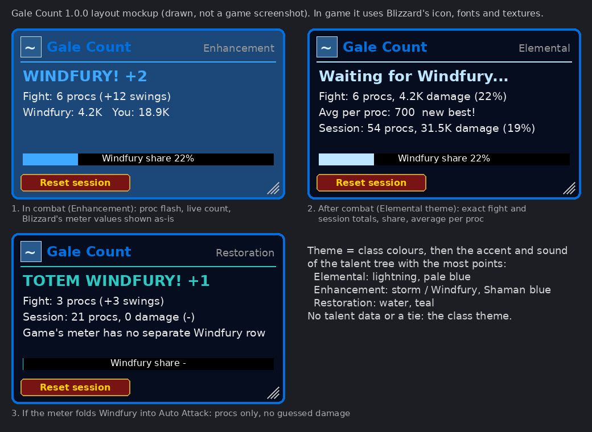

# Gale Count (WoW: Forever) v1.0.0

  

A Windfury tracker for Shamans. A small storm-blue box flashes **WINDFURY!** every time Windfury procs and keeps count. When the fight ends it shows how much damage Windfury did, its share of your damage and the average per proc, taken from the game's own damage meter.

## What it shows
- **Every proc, live:** the box lights up with `WINDFURY! +2` (Windfury Weapon) or `TOTEM WINDFURY! +1` (Windfury Totem, yours or another Shaman's).
- **This fight:** procs and extra swings; after combat, Windfury damage, Windfury's share of your damage and average damage per proc.
- **This session:** procs, Windfury damage and share, average per proc and your best fight average. The **Reset session** button starts a new session.
- **Share bar:** Windfury's share of your damage.

## Where the numbers come from
WoW: Forever runs on the modern client, which gives addons **no combat log**, and every single hit's damage reaches addons as a hidden ("secret") value. Gale Count never guesses a number:
- **Procs** are exact. Each Windfury proc is its own game spell, and the game tells addons when you gain it.
- **Damage** comes from **Blizzard's built-in damage meter**. During combat its numbers are hidden from addon maths, so the box shows them exactly as the game hands them over. Once combat ends they are normal numbers, and Gale Count works out the fight and session totals, share and average.
- **Biggest single proc is not shown.** The game does not let addons read single hits on this client, so no addon can measure one proc's damage. Average per proc is exact.
- If the game's meter counts Windfury's extra swings as ordinary Auto Attack (it then has no Windfury line of its own), the box says **"counting procs only"** and shows proc counts without damage. `/galecount meter` lists the meter's lines for your last fight so you can see what the game reports.

Turn on the game's meter if the box shows no damage: **Options > Gameplay > Advanced > Damage Meter > Enable Damage Meter**.

## Theme
The box takes your **class** colours, then the accent colour and sound of the **talent tree with the most points**:

| Class | Tree | Accent | Sound |
| --- | --- | --- | --- |
| Shaman | Elemental | pale lightning blue | lightning bolt impact |
| Shaman | Enhancement | Shaman blue | shaman thunder (storm) |
| Shaman | Restoration | water teal | water shield |
| Mage | Arcane / Fire / Frost | violet / orange / ice | arcane explosion / fireball / frost nova |
| Warlock | Affliction / Demonology / Destruction | shadow purple / fel violet / fel green | shadow / fel armor / chaos bolt |

Every class has its own entry (Warrior, Paladin, Hunter, Rogue, Priest, Druid too). With no talent points spent or a tie, you get the class theme. All of it is one small table in `Themes.lua`: change a colour (hex `RRGGBB`) or a sound (a game FileDataID) and `/reload`. Every sound and texture is built into the game; nothing is bundled.

## Thunder
`/galecount sound streak` (default): thunder when Windfury procs **2 times within 4 seconds** (`/galecount streak 3 6` makes it 3 procs within 6 seconds).
`/galecount sound every`: every proc. `/galecount sound record`: when a fight beats your best average per proc. `/galecount sound off`.
`/galecount soundfile theme|thunder|crack|bolt` picks the sound (and plays it once). `theme` uses your talent tree's sound.

## Commands
Alias: `/gale`.
`/galecount show` / `hide` · `lock` / `unlock` · `resetpos` · `scale 0.5-2` · `size <width> <height>` · `reset` (session) · `test` (preview a proc out of combat) · `sound …` · `soundfile …` · `streak <procs> <seconds>` · `theme` (re-check your talents) · `meter` · `debug` · `report`

Move the box by dragging it; resize it with the corner grip. Both stop working while it is locked.

## Install
1. Download the zip, or clone this repo into a folder named `GaleCount`.
2. Put the `GaleCount` folder in `World of Warcraft\_forever_\Interface\AddOns\` (the folder next to `_retail_`; the exact name may differ).
3. Restart the game or type `/reload`, and check Gale Count is ticked in the AddOns list.

## In-game test checklist
1. The box appears below the middle of the screen, can be dragged and resized, and keeps its place and size after `/reload`. `/galecount lock` stops both.
2. With Windfury Weapon on, fight a mob: the box flashes `WINDFURY! +2` on each proc and the fight count goes up.
3. In a group with another Shaman's Windfury Totem: `TOTEM WINDFURY! +1` appears on totem procs.
4. Two procs within 4 seconds play one thunder.
5. After the fight: Windfury damage, share and average per proc appear, or "counting procs only". `/galecount meter` lists the meter lines.
6. Spend talent points mostly in Elemental, Enhancement or Restoration: `/galecount theme` names that tree and the box's accent changes.
7. **Reset session** sets the session line back to 0.
8. No Lua errors and no "action blocked" messages during combat.

## Licence
MIT. Written from scratch; no code copied from other addons.
